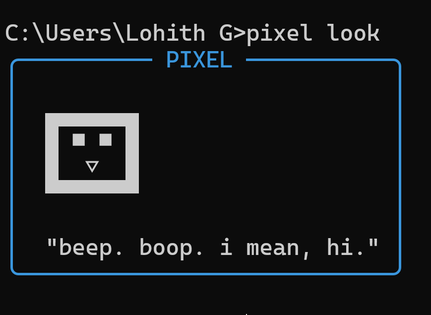

### PIXEL — Terminal AI Assistant

<p align="center">
  <strong>A lightweight AI assistant that lives in your terminal.</strong>
</p>

<p align="center">
  Chat with AI · Run commands · Manage tasks · Take notes · Set reminders
</p>

<p align="center">
  
</p>

---

## About

**PIXEL** is a lightweight command-line AI assistant designed to work directly from your terminal.

It combines AI-powered conversations with practical offline tools for managing notes, to-dos, reminders, terminal commands, and custom aliases.

PIXEL uses **Groq** for AI conversations, while its local utilities work offline and store data on your machine.

---

## Features

| Feature | Description |
|---|---|
| **AI Chat** | Talk to PIXEL directly from your terminal |
| **Mood System** | Switch between `normal`, `focused`, `debugging`, and `roast` personalities |
| **Command Execution** | Generate terminal commands and review them before execution |
| **Notes** | Quickly save and view notes locally |
| **To-Dos** | Add, list, and complete tasks |
| **Reminders** | Create and manage reminders |
| **Custom Aliases** | Create shortcuts for applications, commands, and scripts |
| **Global Access** | Run `pixel` from any directory without activating a virtual environment |

---

## Installation

### Requirements

Before installing PIXEL, make sure you have:

- Python 3.10 or later
- Git
- A Groq API key
- Windows PowerShell

### 1. Clone the repository

```powershell
git clone https://github.com/Lohith848/Pixel.git
cd Pixel
```

### 2. Configure the environment

Create your `.env` file:

```powershell
copy .env.example .env
```

Open `.env` and add your Groq API key.

```env
GROQ_API_KEY=your_api_key_here
```

> Never commit your `.env` file or API key to GitHub.

### 3. Install pipx

PIXEL can be installed with `pipx` so the `pixel` command is available globally.

```powershell
py -m pip install --user pipx
py -m pipx ensurepath
```

Close and reopen PowerShell after running `ensurepath`.

Verify the installation:

```powershell
pipx --version
```

### 4. Install PIXEL

From inside the PIXEL project directory:

```powershell
pipx install -e .
```

PIXEL is now ready to use.

---

## Quick Start

Once installed, PIXEL can be launched from **any directory**.

```powershell
pixel look
```

Talk to PIXEL:

```powershell
pixel "hello"
```

Ask a question:

```powershell
pixel "explain recursion simply"
```

No virtual environment activation or project directory navigation is required.

---

## Commands

### AI

| Command | Description |
|---|---|
| `pixel "your message"` | Chat with PIXEL |
| `pixel do "task"` | Generate a terminal command |
| `pixel mood <mood>` | Change PIXEL's personality |
| `pixel look` | Display the PIXEL mascot |

Example:

```powershell
pixel "explain what this git command does"
```

### Mood System

PIXEL supports multiple personalities:

```powershell
pixel mood normal
pixel mood focused
pixel mood debugging
pixel mood roast
```

| Mood | Behaviour |
|---|---|
| `normal` | Friendly general-purpose assistant |
| `focused` | Short and direct responses |
| `debugging` | Focused on technical problems and code |
| `roast` | More sarcastic and playful responses |

### Command Execution

Ask PIXEL to generate a terminal command:

```powershell
pixel do "find all python files"
```

PIXEL displays the generated command and asks for confirmation before executing it.

### Notes

Add a note:

```powershell
pixel note "idea: build a terminal dashboard"
```

View notes:

```powershell
pixel note list
```

### To-Dos

Add a task:

```powershell
pixel todo add "fix login bug"
```

View open tasks:

```powershell
pixel todo list
```

View all tasks:

```powershell
pixel todo list --all
```

Complete a task:

```powershell
pixel todo done <id>
```

### Reminders

Create a reminder:

```powershell
pixel remind "submit assignment" --at "6pm"
```

View pending reminders:

```powershell
pixel remind list
```

### Custom Aliases

PIXEL can launch applications or run frequently used commands through aliases configured in `.env`.

For example:

```powershell
pixel open vscode
```

---

## Global Terminal Access

PIXEL is installed using `pipx`, which keeps it in an isolated Python environment while making the command globally available.

Instead of doing this every time:

```powershell
cd Pixel
.\venv\Scripts\activate
pixel look
```

You can simply open a terminal anywhere and run:

```powershell
pixel look
```

or:

```powershell
pixel "what can you do?"
```

---

## Development

PIXEL is installed in editable mode using:

```powershell
pipx install -e .
```

This means changes to the Python source code are reflected in the installed `pixel` command, making development and testing easier.

To uninstall PIXEL:

```powershell
pipx uninstall pixel
```

> If your package name registered with pipx is different, use `pipx list` to find the installed package name.

---

## Privacy

PIXEL is designed to keep local utilities local.

- Notes, to-dos, reminders, and aliases are stored locally.
- AI conversations require an internet connection and use the configured Groq API.
- Your Groq API key is stored in your local `.env` file.
- The `.env` file should never be committed to the repository.

---

<p align="center">
  <strong>PIXEL</strong><br>
  Your terminal. Your assistant. One command away.
</p>
